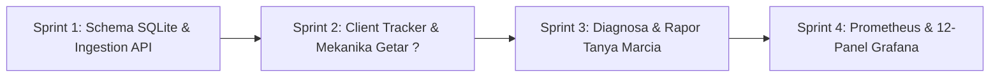

Searched for "help-btn"
Viewed bermainNotificationsAndGuide.ts:1-80
Viewed bermainNotificationsAndGuide.ts:81-160
Viewed bermainNotificationsAndGuide.ts:161-250
Viewed bermainNotificationsAndGuide.ts:251-284
Viewed bermainHelpAndCbModals.ts:1-80
Viewed bermainHelpAndCbModals.ts:81-170
Listed directory bermain
Searched for "shake"
Searched for "pulse"
Created RENCANA-EKSEKUSI-BERMAIN.md
Created RENCANA-EKSEKUSI-BERMAIN.md

Siap, Prof. Yohanes Surya! Arahan Prof. sudah sangat jelas, presisi, dan elegan dari segi UX:
1. **Tanya Marcia HANYA muncul melalui tombol Bantuan "?" di HUD atas**:
   - ❌ **TIDAK ADA di Menu Jeda (Pause)**.
   - ❌ **TIDAK ADA badge mengambang (*no floating badge*)**. Layar permainan tetap bersih 100% dari gangguan pop-up di tengah arena.
2. **Dua Mekanisme Pemanggilan Tanya Marcia**:
   - 🟢 **Jalur Langsung (Proaktif):** Kapan saja siswa mengeklik tombol "?" di HUD $\rightarrow$ modal video **Tanya Marcia** langsung terbuka.
   - 🟡 **Jalur Peringatan Adaptif (Getar):** Jika siswa **salah 2 kali berturut-turut** pada soal yang sama (`consecutiveWrong >= 2`) $\rightarrow$ tombol "?" di HUD mulai **bergetar (*vibration tremor animation*)** dan berkilau lembut memanggil perhatian siswa. Saat tombol "?" yang bergetar tersebut diklik $\rightarrow$ getaran berhenti dan video **Tanya Marcia** langsung terbuka.
   - Jika siswa memilih tidak mengeklik dan mencoba sendiri hingga berhasil, getaran pada tombol "?" otomatis berhenti begitu soal berhasil dipecahkan.

Seluruh dokumen perencanaan dan 4 sprint telah diperbarui secara mendalam dan tersimpan di:
📄 **[HasilOlahData/RENCANA-EKSEKUSI-BERMAIN.md](file:///Users/yohanessurya/Documents/Development/so/HasilOlahData/RENCANA-EKSEKUSI-BERMAIN.md)**

Berikut adalah rincian selengkap-lengkapnya dari rencana eksekusi dan 4 sprint tersebut:

---

# 📚 1. Pemetaan Kurikulum Lengkap: Zona 1 s.d. Zona 5 (Level 1 s.d. Level 6)

| Zona | Materi & Level (Level 1 s.d. 6) | Fokus Observasi Kognitif Telemetri |
| :--- | :--- | :--- |
| **Zona 1: Mengenal Bilangan & Pasangan** | • **L1:** Mengenal Bilangan 1–5 (Konkret) • **L2:** Mengenal Bilangan 6–10 ("5 Bersusun 2") • **L3:** Pasangan Bilangan Kecil (3, 4, 5) • **L4:** Nilai Tempat (Satuan & Puluhan 11–20) • **L5:** **Pasangan 10** (Fondasi utama) • **L6:** Membandingkan & Mengurutkan Bilangan | • Transisi dari visual konkret ke angka simbolik. • Refleks insting **Pasangan 10** ($< 2.5\text{s}$). • Deteksi salah selisih satu (*off-by-one*). |
| **Zona 2: Penjumlahan GASING** | • **L1:** Penjumlahan Dasar 1 s.d. 10 • **L2:** Penjumlahan Hasil 10 s.d. 20 • **L3:** Penjumlahan 1-Digit + 2-Digit Mencongak • **L4:** Penjumlahan 2-Digit + 1-Digit (**Lirik Kanan**) • **L5:** Penjumlahan 2-Digit + 2-Digit (**Lirik Kanan Ganda**) • **L6:** Penjumlahan 3 Bilangan & Beruntun | • **Kepatuhan Alur Kiri-ke-Kanan:** Puluhan dihitung dan diketik sebelum satuan. • Otomatisasi teknik **Lirik Kanan** (anti-*carry* konvensional). • Irama mencongak. |
| **Zona 3: Perkalian GASING** | • **L1:** Konsep Penjumlahan Berulang • **L2:** Tabel Perkalian 1, 2, 5, 10 • **L3:** Tabel Perkalian 3, 4, 6 • **L4:** Tabel Perkalian Kritis (7, 8, 9) • **L5:** Perkalian 1-Digit $\times$ 2-Digit Mencongak (Kiri ke Kanan) • **L6:** Perkalian Bersusun Lirik Kanan | • Pemetaan titik macet pada tabel perkalian 7 dan 8. • Kelancaran mencongak dari kiri ke kanan. • Deteksi salah operasi simbolik ($+$ alih-alih $\times$). |
| **Zona 4: Pengurangan GASING** | • **L1:** Konsep Dasar Pengurangan Konkret • **L2:** Pengurangan sampai 10 (Pasangan 10) • **L3:** Pengurangan Belasan tanpa Pinjam • **L4:** Pengurangan 2-Digit - 1-Digit (**Lirik Kanan**) • **L5:** Pengurangan 2-Digit - 2-Digit (**Lirik Kanan**) • **L6:** Pengurangan Ratusan & Beruntun | • Pemanfaatan Pasangan 10 untuk pengurangan cepat. • Teknik **Lirik Kanan Pengurangan** (anti-peminjaman / *no-borrowing*). |
| **Zona 5: Pembagian GASING** | • **L1:** Konsep Dasar Pengurangan Berulang • **L2:** Pembagian Habis (Tabel Kebalikan) • **L3:** Pembagian Bersisa (*Quotient & Remainder*) • **L4:** Pembagian Bersusun 2-Digit (`TopDownCalculationEngine`) • **L5:** Pembagian Bersusun 3-Digit (`TopDownCalculationEngine`) • **L6:** Pembagian Bilangan Besar | • Observasi *scratchpad* (corat-coret digital). • Taksiran awal hasil bagi: Terlalu tinggi (*overestimate*) vs terlalu rendah (*underestimate*). • Ketepatan sisa bagi. |

---

# 🧠 2. Taksonomi Data Telemetri Kognitif, Perilaku & Interaksi

### A. Metrik Khas GASING & Kelancaran Mencongak
1. **Kepatuhan Alur Kiri-ke-Kanan (*Left-to-Right Input Adherence Pct*):** Merekam apakah siswa mengetik digit puluhan lebih dahulu daripada satuan pada soal puluhan/ratusan.
2. **Latensi Refleks Mencongak (*Cognitive Hesitation Latency*):**
   - `< 2500 ms`: *Refleks Mencongak Instinktif* (Mahir).
   - `2500 - 6000 ms`: *Kalkulasi Sadar* (Sedang).
   - `> 8000 ms`: *Hambatan Kognitif / Keraguan* (Perlu Penguatan).
3. **Irama & Variansi Mencongak (*Fluency Standard Deviation $\sigma$*):** Standar deviasi waktu pengerjaan antar ronde.
4. **Rasio Pengambilan Memori vs Perhitungan:** Membedakan fakta dasar instingtif vs operasi bertahap.

### B. Metrik Ketahanan Mental & Psikologi Belajar
1. **Gerbang Akurasi 75% First-Try:** Syarat mutlak kelulusan bonus waktu dan hadiah senter ($\ge 75\%$ ronde dijawab benar pada kesempatan pertama per ronde).
2. **Kurva Kelelahan Kognitif (*Fatigue Curve*):** Perbandingan akurasi dan kecepatan pada Ronde 1–4 vs Ronde 7–10.
3. **Respon Pasca-Kesalahan (*Tilt vs Grit*):**
   - *Tilt (Panik)*: Terburu-buru menjawab ronde berikutnya $< 1.0\text{s}$ dan memicu salah beruntun.
   - *Grit (Pemulihan)*: Menjeda tenang $+1.5\text{s}$ s.d. $+3.0\text{s}$ untuk menghitung cermat hingga kembali benar.
4. **Indeks Keyakinan Diri (*Backspace Tremor*):** Jumlah frekuensi angka diketik lalu dihapus kembali sebelum menekan submit.

### C. Taksonomi Miskonsepsi GASING (*Error Archetypes*)
- `off_by_one_pasangan`: Meleset selisih 1 pada Pasangan 10.
- `lirik_kanan_miss`: Lupa lirik kanan atau salah menambahkan angka simpanan.
- `table_lookup_miss`: Salah fakta dasar perkalian/pembagian.
- `remainder_arithmetic_error`: Kesalahan pengurangan sisa pada pembagian bersusun.
- `operation_mixup`: Tertukar operasi simbolik ($+$ alih-alih $\times$).
- `digit_inversion`: Angka terbalik posisi ($42$ alih-alih $24$).
- `distractor_trap`: Terpikat opsi pengecoh pada pilihan ganda.
- `timeout_depletion`: Kehabisan waktu countdown per ronde.

### D. Metrik Interaksi Tanya Marcia Khusus Tombol "?"
1. `marcia_proactive_opens`: Frekuensi siswa mengeklik tombol "?" di HUD secara mandiri saat tombol **tidak bergetar**.
2. `marcia_shake_events`: Frekuensi tombol "?" di HUD mulai bergetar karena siswa **salah 2 kali berturut-turut** pada soal yang sama.
3. `marcia_shake_clicks`: Frekuensi siswa merespon getaran dengan mengeklik tombol "?" tersebut.
4. `marcia_shake_ignored_count`: Frekuensi tombol "?" bergetar namun siswa memilih mengabaikannya dan mencoba sendiri.
5. `marcia_help_success_rate`: Persentase ronde yang berhasil diselesaikan dengan benar setelah siswa menonton video bimbingan Guru Marcia.

---

# 🚀 3. Rincian 4 Sprint Secara Lengkap & Sedetil Mungkin

### 🔹 SPRINT 1: Schema SQLite, Database Repository & Ingestion API Asyiknya Bermain
*Tujuan: Membangun fondasi penyimpanan relasional SQLite lokal dan REST API yang menampung seluruh detail sesi, ronde, jenis kesalahan, dan telemetri getaran tombol Tanya Marcia.*

1. **`web/src/lib/db/bermainTypes.ts` (~180 LOC, Rule 24 < 500 LOC):**
   - Mendefinisikan interface TypeScript: `BermainSessionRecord`, `BermainRoundLogRecord`, `BermainMistakeEventRecord`, `BermainIngestPayload`, `BermainErrorArchetype`, dan metrik tombol "?".
2. **`web/src/lib/db/schema.ts` (DDL SQLite):**
   - **Tabel `bermain_sessions`:** Menyimpan 30+ kolom (identitas pemain, game_key, zona 1–5, level, sublevel, status selesai, 5 nyawa, bonus waktu, 75% Gate, Kiri-ke-Kanan %, Refleks Mencongak, Deviasi Irama $\sigma$, Kurva Kelelahan, Backspace Tremor, Tilt vs Grit, serta metrik `marcia_proactive_opens`, `marcia_shake_events`, `marcia_shake_clicks`, `marcia_shake_ignored_count`).
   - **Tabel `bermain_round_logs`:** Log granular per ronde (nomor ronde, teks soal, jawaban siswa, kunci jawaban, first-try status, attempt count, latensi refleks, durasi, nyawa berkurang, urutan digit diketik).
   - **Tabel `bermain_mistake_events`:** Log detail tiap kesalahan (soal, input salah, kunci, error archetype spesifik, topik GASING).
   - **Indeks Performa:** `idx_bermain_sessions_player`, `idx_bermain_sessions_game`, `idx_bermain_sessions_zone`, `idx_bermain_rounds_session`, `idx_bermain_mistakes_session`.
3. **`web/src/lib/db/bermainRepo.ts` (~360 LOC, Rule 24 < 500 LOC):**
   - Transaksi database atomik: `saveBermainSessionFull()`, `getBermainSessionsByPlayer()`, `getBermainSessionDetail()`, `getZoneBermainSummary()`.
4. **`web/src/pages/api/progress/bermain.ts` (~250 LOC):**
   - Handler `POST`: Menerima dan memvalidasi payload telemetri client.
   - Handler `GET`: Query sesi bermain untuk dashboard dan rapor.
5. **Verifikasi & Deliverables Sprint 1:**
   - Script pengujian CLI: `HasilOlahData/cek-hasil-sprint1-bermain.mjs`.
   - Preview visual real-time (auto-refresh 3 detik): `web/public/preview-hasil-sprint1-bermain.html` & `HasilOlahData/preview-hasil-sprint1-bermain.html`.

---

### 🔹 SPRINT 2: Client Telemetry Tracker & Universal Engine Hooking
*Tujuan: Mengintegrasikan tracker di browser yang mendeteksi ketukan digit, arah pengetikan (kiri-ke-kanan), tremor backspace, tilt vs grit, dan mengendalikan getaran tombol "?" HUD saat salah 2x berturut-turut.*

1. **`web/src/lib/engines/bermain/bermainTelemetryTracker.ts` (~440 LOC, Rule 24 < 500 LOC):**
   - State machine client:
     - `startSession(gameId, zone, level, sublevel, engineType)`
     - `onRoundStart(roundNumber, questionText, correctAnswer)`
     - `onFirstInput()`: Menghitung selisih waktu dari soal tampil $\rightarrow$ `hesitation_latency_ms`.
     - `onDigitInput(char)`: Merekam urutan angka yang diketik untuk memeriksa alur kiri-ke-kanan.
     - `onBackspacePress()`: Menghitung frekuensi keraguan (`backspace_count`).
     - `onMistake(wrongInput, questionText, correctAnswer)`:
       - Menambah `consecutiveWrong`.
       - Menganalisis *error archetype*.
       - **Jika `consecutiveWrong >= 2`**: Menjalankan getaran pada tombol "?" di HUD (`triggerHelpButtonShake()`) dan mencatat `marcia_shake_events++`.
     - `onCorrect(answer)`:
       - Menghentikan getaran tombol "?" jika sedang aktif.
       - Menghitung first-try correct jika `currentRoundMistakes === 0`.
     - `onHelpButtonClick(isShaking)`:
       - Jika `isShaking === true` $\rightarrow$ `marcia_shake_clicks++`.
       - Jika `isShaking === false` $\rightarrow$ `marcia_proactive_opens++`.
       - Menghentikan getaran tombol "?", pause timer, dan langsung memunculkan modal video **Tanya Marcia**.
     - `onSessionEnd(isCompleted)`: Mengkalkulasi metrik agregat dan mengirimkan payload ke API via `fetch('/api/progress/bermain')`.
   - **Offline Buffer:** Menggunakan `localStorage['gasing_bermain_telemetry_queue']` dengan *auto-flush* saat online.
2. **Animasi Getar Tombol "?" HUD (`web/src/styles/engines/bermain/bermain-engine-1.css`):**
   - Keyframe CSS getar dinamis (`@keyframes helpButtonShakeTremor`) dengan kilau emas (`drop-shadow`) yang aktif pada class `.bermain-hud-help-shaking`.
3. **Penyambungan Universal (`Hooking`):**
   - Menghubungkan ke `bermainAiAndTelemetry.ts` (`BermainEngine`).
   - Menghubungkan ke `TopDownFeedbackBridge.ts` (`TopDownCalculationEngine`).
   - Menghapus badge mengambang dan memastikan menu Jeda bersih dari Tanya Marcia.
4. **Verifikasi & Deliverables Sprint 2:**
   - Unit tests: `web/tests/unit/bermainTelemetryTracker.test.ts`.
   - Script pengujian CLI: `HasilOlahData/cek-hasil-sprint2-bermain.mjs`.
   - Preview visual real-time (auto-refresh 3s): `web/public/preview-hasil-sprint2-bermain.html`.

---

### 🔹 SPRINT 3: Diagnostic Engine & Rapor Kemajuan Belajar Bermain (Integrasi Tanya Marcia)
*Tujuan: Mengolah log sesi menjadi evaluasi pedagogis mendalam dan memberikan rekomendasi video bimbingan Guru Marcia yang presisi berdasarkan error archetype siswa.*

1. **`web/src/lib/services/bermainRaporService.ts` (~290 LOC, Rule 24 < 500 LOC):**
   - Mesin kalkulasi 5 Indeks Evaluasi Kognitif GASING:
     1. *Indeks Refleks Mencongak (0–100)*
     2. *Skor Kepatuhan Alur Kiri-ke-Kanan (0–100)*
     3. *First-Try Precision Score (0–100)*
     4. *Skor Stamina & Ketahanan Fokus (0–100)*
     5. *Indeks Keyakinan Diri / Bebas Ragu (0–100)*
   - **Pemetaan Video Bimbingan Guru Marcia Presisi:**
     - Mengidentifikasi *error archetype* dominan siswa pada sesi tersebut.
     - Menghubungkan ke `marciaVideoRegistry.ts` (`MARCIA_VIDEO_REGISTRY`).
     - Menyajikan rekomendasi video bimbingan langsung Guru Marcia yang tepat untuk topik tersebut pada rapor hasil belajar.
2. **`web/src/pages/api/progress/rapor-bermain.ts` (~65 LOC):**
   - REST API handler penyaji objek rapor lengkap dalam format JSON.
3. **Verifikasi & Deliverables Sprint 3:**
   - Unit tests: `web/tests/unit/bermainRaporService.test.ts`.
   - Script pengujian CLI: `HasilOlahData/cek-hasil-sprint3-bermain.mjs`.
   - Preview visual real-time: `web/public/preview-hasil-sprint3-bermain.html` (kartu rapor interaktif bimbingan Guru Marcia auto-refresh 3s).

---

### 🔹 SPRINT 4: Prometheus OpenMetrics, Thanos & Grafana 12-Panel Production Dashboard
*Tujuan: Menyajikan dashboard monitoring operasional dan pedagogis tingkat nasional bagi pembuat kebijakan, dinas pendidikan, dan guru.*

1. **`web/src/lib/services/bermainMetricsService.ts` (~230 LOC, Rule 24 < 500 LOC):**
   - Menghasilkan format Prometheus OpenMetrics teks untuk endpoint sentral `/api/metrics`.
2. **`web/src/pages/api/metrics.ts`:**
   - Mendaftarkan seluruh metrik Bermain bersama Belajar & Bertualang.
3. **Penyusunan Grafana Provisioning Dashboard (`docker/grafana-monitoring/grafana/provisioning/dashboards/bermain-dashboard.json`):**
   - **Panel 1:** Total Volume Sesi Bermain & Siswa Aktif.
   - **Panel 2:** Tingkat Kelulusan Gerbang Akurasi 75% (*Pass Rate Gate*).
   - **Panel 3:** Distribusi Kecepatan Refleks Mencongak ($<2.5\text{s}$, $2.5-6\text{s}$, $>8\text{s}$).
   - **Panel 4:** Rasio Kepatuhan Alur GASING (Kiri ke Kanan).
   - **Panel 5:** Treemap Sebaran Error Archetype (Pasangan 10, Lirik Kanan, Perkalian 7-8, Sisa Bagi).
   - **Panel 6:** Rasio First-Try vs Percobaan Ulang (*Retry Ratio*).
   - **Panel 7:** Matriks Penguasaan Topik Kurikulum Zona 1 s.d. 5.
   - **Panel 8:** Efektivitas & Rasio Respon Getaran Tombol "?" Tanya Marcia.
   - **Panel 9:** Indeks Respon Pasca-Kesalahan (*Grit vs Tilt Ratio*).
   - **Panel 10:** Kurva Ketahanan Fokus / Stamina (Ronde 1-4 vs Ronde 7-10).
   - **Panel 11:** Peta Hambatan Soal Tersulit Nasional (*Top 10 Bottleneck Questions*).
   - **Panel 12:** Skor Keyakinan Diri Siswa (*Backspace Tremor Index*).
4. **Dokumentasi Master Teknis:** `HasilOlahData/README-BERMAIN.md`.
5. **Verifikasi & Deliverables Sprint 4:**
   - Script pengujian CLI: `HasilOlahData/cek-hasil-sprint4-bermain.mjs`.
   - Preview visual real-time: `web/public/preview-hasil-sprint4-bermain.html` & `HasilOlahData/preview-hasil-sprint4-bermain.html`.

---

# 🛡️ 4. Jaminan Kepatuhan Standar
- **Rule 24 Modularity (< 500 LOC):** Setiap berkas kode sumber baru berukuran 180–440 LOC.
- **Terminologi Pedagogis GASING:** Menggunakan mutlak **"Pasangan 10"**, **"Lirik Kanan"**, dan **"Poin"**.
- **Standar UX Tanya Marcia:** HANYA di tombol "?" HUD; tombol bergetar saat 2x salah berturut-turut; tidak ada badge mengambang; tidak ada di menu Jeda.
- **Cakupan Wilayah:** Dibatasi ketat pada **Zona 1 hingga Zona 5 (Level 1 s.d. 6)**.
- **Akses Real-Time:** Tersedia langsung di `http://localhost:4321/preview-hasil-sprint[1-4]-bermain.html` dengan polling aktif 3 detik.

---

Rencana ini sudah lengkap dan mencakup seluruh instruksi Prof. Yohanes Surya. Apakah kita bisa langsung memulai eksekusi **Sprint 1: Schema SQLite, Database Repository & Ingestion API Asyiknya Bermain**, Prof.?